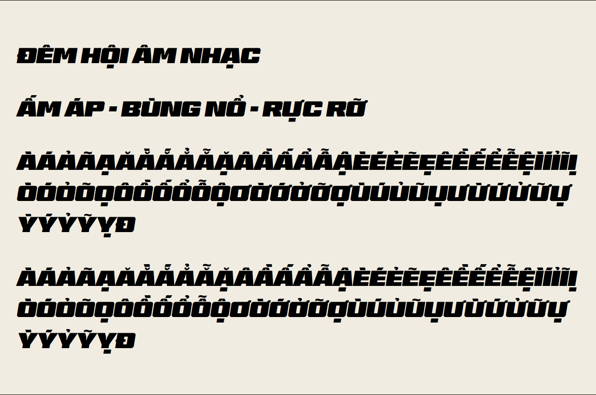

# BT Brik tiếng Việt bằng VinaDấu

Đã dùng bộ tạo dấu thật của VinaDấu tại bản nguồn `7f0a11fc950773d2e65af7bfef6fee51cf0ae6a2`, thay cách chuyển tiêu đề Việt sang sans. Công cụ mở trình duyệt tương tác không kết nối được nên chạy trực tiếp engine của VinaDấu trên máy. Không chỉnh mã nguồn VinaDấu.

- Tạo 95 ký tự mới và giữ 40 ký tự đã có, đủ 135 ký tự trong bảng Việt của VinaDấu.
- 380 glyph gốc giữ nguyên outline và toàn bộ hmtx, GSUB giống từng byte khi reviewer kiểm độc lập. Tổng sau bổ sung là 475 glyph. Giữ copyright, tác giả, đơn vị phát hành và URL giấy phép gốc.
- Sáu loại dấu lấy từ font gốc; hỏi và móc dùng thư viện thích ứng của VinaDấu. Ghi nhận từng nguồn trong [báo cáo tạo](generation.json) và [thông tin font](../../../public/fonts/NOTICE.md).
- Giới hạn dọc của WOFF2 chứa mực từ -247 đến 1001; giãn dòng tiêu đề Việt 1,28. Bản xuất mất hinting gốc theo giới hạn hiện tại của VinaDấu; không mất bảng layout của font này.

## Ảnh mẫu

| Màn hình | Tiêu đề tiếng Việt | Trang mẫu |
|---|---|---|
| Điện thoại 320px | [Ảnh](dj-vi-320.png) | [Ảnh](lineup-vi-320.png) |
| Điện thoại 390px | [Ảnh](dj-vi-390.png) | [Ảnh](lineup-vi-390.png) |
| Tablet 768px | [Ảnh](dj-vi-768.png) | [Ảnh](lineup-vi-768.png) |
| Máy tính 1280px | [Ảnh](dj-vi-1280.png) | [Ảnh](lineup-vi-1280.png) |
| Máy tính 1440px | [Ảnh](dj-vi-1440.png) | [Ảnh](lineup-vi-1440.png) |

## Kiểm chứng

[Kết quả Chrome](browser-results.json) đọc `CSS.getPlatformFontsForNode`, xác nhận từng glyph mẫu thực sự dùng BT Brik 3XL Viet ở cả năm kích thước. Không thấy font dự phòng, lỗi JavaScript, tràn ngang hoặc dấu chồng cao hơn hộp dòng; chuỗi đầu vào NFD được hiển thị NFC qua luồng backend demo thật. [13/13 ca đặt bàn](../regression.json) vẫn đạt, gồm chặn tải font để thử dự phòng.

Kết quả hình học VinaDấu trước khi mở rộng giới hạn dọc là 89/100: không có va dấu hoặc móc rời; còn cảnh báo chiều cao theo giới hạn gốc và 12/114 mẫu dấu ngoài khoảng kích thước khuyến nghị. Giới hạn dọc đã được chỉnh ở bước đóng gói; cảnh báo kích thước được kiểm bằng ảnh, không xóa khỏi báo cáo. Reviewer thị giác không thấy lỗi cần chặn trong bảng mẫu và các trang đã chụp.

Ba reviewer độc lập duyệt: JavaScript, đóng gói/font và hiển thị. Đây là dữ liệu demo cục bộ; chưa merge hoặc kiểm triển khai production. [Cách tạo lại font](../../../tools/fonts/README.md), [cách chạy kiểm tra](../../../tools/qa/README.md).
